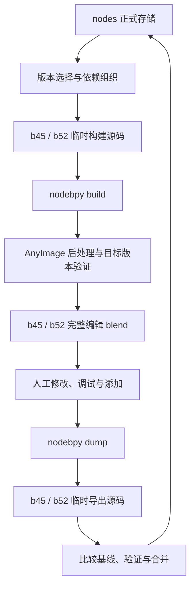

## Context

正式存储直接采用 nodebpy 导出的代码，共享实现只保存一份。分版本目录是临时转换输入输出，人工编辑库也是分版本的完整库。



5.2 Depth Cutout 往返及 AnyImage 整理已有试验依据；4.5 能打开整理后的文件，但尚未验证全部求值与配置。nodebpy 当前没有发布 450.x，不能假设换 Blender executable 就能直接构建 b45。

## Goals / Non-Goals

**Goals**

- 直接保存 nodebpy 导出的模块，复用其 build、dump 与组依赖处理。
- 共用实现存一份，不同版本保存独立完整实现。
- 两个版本的人工编辑库完整、可维护，回写稳定且程序化。
- 保留现有资产库划分与发布流程。

**Non-Goals**

- 设计另一种节点源码格式、注册协议或节点 DSL。
- 保存空间布局到正式节点逻辑，或依靠 LLM 回写。
- 用公共逻辑加补丁的方式拼装节点。

## Decisions

### 1. nodes 保存原生导出模块，文件名决定版本选择

节点代码保留 nodebpy 的类、`ASSET`、`ASSET_METADATA` 和依赖引用等原生格式，不再要求 `NODE_GROUPS` 注册列表或手写另一份创建函数。导出代码本身包含创建方法，项目不另外维护等价源码。

采用 nodebpy 的自然划分：每个资产一个模块；单个资产专用的辅助组内嵌；多个资产共用的辅助组放入 `_shared/`。保留 Geometry、Shader、Compositor 分类。材料及外部资源沿用后端支持方式，无法可靠重建的依赖必须报错。

每个资产库使用一份简洁配置记录所属 `.blend` 文件、稳定组 ID 和必要依赖映射。版本归属由文件名决定，不另行维护 `blender_version` 列表，也不向原生导出代码加入项目专属版本语法。组身份由去掉版本后缀后的逻辑模块路径、稳定 ID 与节点树类型确定。

概念上的存储划分如下，具体模块名与目录沿用 nodebpy 的导出命名：

```text
nodes/O_Essentials/
  library.json
  geometry/
    node_a.py          # b45、b52 共用
    node_b.py          # 通用完整实现，至少支持 b45
    node_b.b52.py      # 同名组的完整 b52 专用实现
    node_c.b52.py      # 仅 b52
    _shared/
      helper.py
```

`node_a.py` 表示尽可能通用的完整实现，最低支持 b45；在当前两个目标中，b45 选择它，b52 没有专用文件时也选择它并验证兼容。`node_a.b52.py` 表示仅用于 b52 的完整实现，不用于 b45，也不自动用于未来版本。

两者并存时，b45 选择 `node_a.py`，b52 优先选择 `node_a.b52.py`。仅有 `.b52.py` 时，该组是 b52 特有。专用文件独立完整，不与通用文件合并节点逻辑。没有专用文件的通用实现若在 b52 验证失败，则必须报错或补齐专用实现，不能静默遗漏该组。最低 b45 不代表未知未来版本已通过验证。公开节点名和 Socket 名保持原始拼写。

### 2. 临时源码目录解决版本选择和引用

构建时，薄工具按文件名规则选择该目标全部资产及完整依赖，复制到独立临时目录，组织为 nodebpy build 可读取的原生模块布局。选中的 `node_a.b52.py` 在 b52 临时目录中写为 `node_a.py`，导入统一使用逻辑模块名，nodebpy 不需要识别版本后缀。辅助组也遵守相同选择规则。

共享模块可以同时复制进 b45、b52 临时目录，但正式来源只保存一份。临时目录不进入 Git，也不是新的维护来源。选择发生在 nodebpy build 之前，不让两个同名版本同时进入同一次构建。

nodebpy 原生 import 处理资产嵌套和共用辅助组；项目层只负责选择目标实现并组织正确的模块路径和导入。映射以稳定组 ID 为依据，程序化调整导入语句，不通过文本猜测组名。验证依赖闭包、接口和重复命名，保留原始共享关系，不复制出互相分叉的正式定义。

每次构建使用干净、独立的 Blender 进程，避免 nodebpy 按名字复用旧组。跨文件、跨资产库依赖也必须在目标完整编辑库内解析到正确版本；不能指向另一版本、旧源库或发布产物。

O_Extra 依赖 O_Essentials 时，构建自动先准备同版本 O_Essentials，然后将 Extra 中的公共组引用恢复为指向同级 Essentials 文件的相对 linked 引用。nodebpy 的 Python import 只负责创建逻辑，不自动等于 Blender 跨文件 link；恢复链接属于项目工具的必要后处理。

公共组只有一个编辑归属：修改它时打开 O_Essentials 的所属文件；在 O_Extra 中它是 linked 数据，不生成第二份可编辑来源。构建依赖不能覆盖已有未同步修改。sync 从所属文件提取，按资产库回写；依赖库也有修改时一并检查和同步，不能从 Extra 引用副本反写 Essentials。

### 3. nodebpy build 后由 AnyImage 整理

调用 `build_library` 或等价 `nodebpy build`，在当前 Blender 中得到资产及完整依赖。AnyImage 后处理操作内存中的节点树，再保存整理后的完整编辑库；不是直接修改二进制文件。

复用 AnyImage 的完整整理方案：计算分块、局部 Group Input、隐藏未使用 Socket、字段放置、数学折叠、Frame 和 Reroute。接入时控制 nodebpy 自动布局，保证 AnyImage 是最后的整理步骤。移植必要公共函数和尺寸数据，保留来源与许可，不依赖外部项目路径。

布局前后和保存重载后比较逻辑，验证接口、动态配置、连接顺序及必要行为。Geometry、Shader、Compositor 与现有 Zone 的整理覆盖需实际验证，未支持情况明确报错。

逐列中继行仅参与节点排布与通道高度估计，不生成路径点。长线根据最终节点边界
直接分配一条水平通道，在进入与退出位置生成同高 Reroute；同源分支共用通道。
不同通道保持间距，端口转弯穿过其他节点时补短引导点，不再生成或简化台阶路径。

编辑库位于 `workspaces/b45/<资产库>/`、`workspaces/b52/<资产库>/`，保留现有文件划分、分类和相对依赖。两者均包含该目标全部内容。manifest 保存源摘要、后端与 Blender 版本、组映射和逻辑基线。

### 4. dump 到分版本临时目录，再合并到 nodes

人修改并保存编辑库后，用 nodebpy dump 分别生成 b45、b52 的临时导出目录。可以处理一个版本，也可以一次处理两个；未参与本次同步的版本保留正式来源中的内容。

导出在临时副本中消除位置、Frame、Reroute 和重复 Group Input 等布局信息，保留实际求值逻辑，不改人的编辑文件。使用支持读取该文件的 Blender 执行 dump；读取 b45 文件并不要求 dump 后端必须运行在 4.5。

合并按稳定组 ID 对齐，使用内部规范化图比较接口、有效数值、属性、依赖、动态 item、Zone 配对、完整连接和 Multi-input 次序与重复次数。字典仅用于比较。代码文本或 nodebpy 自带 parity 不能单独证明跨版本逻辑一致。

- 两目标逻辑及必要元数据相同：保留一份无后缀模块，删除重复的 `.b52.py`。
- 同名、不同逻辑：b45 完整实现保存为无后缀模块，b52 完整实现保存为 `.b52.py`。
- 新组：通过 b45 且满足通用选择规则时保存为无后缀模块；仅适配 b52 时保存为 `.b52.py`。通过 b45 但 b52 不适配时，需补齐 b52 专用实现或报告未完成，不能用无后缀名称掩盖失败。
- 共享实现只在一个工作区被修改：验证原适配范围；均通过则更新共享实现，仅部分明确适配则拆分并保留另一版本旧内容。
- 两个工作区独立修改同一共享组且结果不同：报告冲突；用户明确选择分版本保存或统一采用某一候选后，再验证合并，不静默覆盖。
- 原本已有不同版本实现：默认只更新被编辑实现的维护范围；跨版本应用通过显式 apply-to。

未改变的模块不重写。源摘要与基线不同则拒绝覆盖；缺失组不是自动删除。候选在临时正式源中合并并重新构建验证，全部通过后更新 `nodes/` 与参与同步的基线，失败恢复全部旧内容。

### 5. b45 通过实际验证，不依赖不存在的 450.x

固定已验证的 nodebpy 5.2 后端。优先试验以下 b45 路径：选择 b45 源码，在支持 nodebpy 的 5.2 中 build 和整理，然后用实际 4.5 打开，检查有效属性、接口、依赖、保存重载及求值，最终由 4.5 保存 b45 编辑库。

实际试验已发现这条路径不能稳定用于全部资产：`O Mix Color` 连续两次 dump/build 后，b45 逻辑节点数为 13、16，跨版本颜色转换持续增加节点。Compositor 的配置和连接也出现变化。必须先解决 b45 转换后端或编译规则，再将此路径用于正式迁移；不能仅凭可打开或一次构建成功交付。

Granules 按用户决定暂缓迁移：原库引用的 `O Center Geometry` 在其目标 Essentials 文件中缺失，保留诊断，不自动猜测替换。

版本适配由完整节点组及依赖的实际验证确定，不只检查是否使用新节点。确定的能力限制允许拆分；后端不可用、崩溃、提取遗漏或行为失败阻止同步，不能为了继续写回而标成仅适配 b52。

### 6. CLI 只保留 build 与 sync

```bash
nodes build nodes/O_Essentials -o workspaces
nodes build nodes/O_Extra -o workspaces
nodes sync nodes/O_Essentials -s workspaces
nodes sync nodes/O_Extra -s workspaces
```

`build` 自动处理 b45、b52，按依赖顺序组织临时源码、调用 nodebpy、整理、恢复跨库链接并验证完整编辑库。`sync` 从指定工作区自动识别现有版本及依赖归属，临时 dump、比较、验证并合并到正式来源。变化报告与必要检查内置，不提供独立 diff、check 命令。目标 bpy 环境由工具自动准备，不需要配置 Blender executable。CLI 不实现第二套节点转换器。

`--apply-to GROUP_ID=b45,b52` 显式统一指定目标的实现；`--delete GROUP_ID` 只删除参与编辑版本的组并检查剩余依赖。删除 b45 而保留 b52 时，将保留的完整实现存为 `.b52.py`；删除 b52 而保留通用文件会触发通用回退，因此此类请求必须报告冲突，不能宣称已从 b52 删除。bootstrap 从旧完整库执行同样的临时导出与验证，建立首次来源。

`build_assets.py` 接收已验证的完整版本工作区，继续执行现有本地、独立本地和远程发布。它仍仅依赖 bpy 和标准库。节点转换与整理属于前置步骤，删除旧 overlay 合并执行路径。

### 7. 本地与 CI 的运行环境

项目开发环境的 nodebpy/bpy 作为 dev 依赖由 uv.lock 锁定，负责 build/dump。
每个目标 Python/bpy 版本统一定义在 pyproject.toml 的 tool.nodes.targets；工具用 uv
自动准备独立缓存环境，所有目标统一执行检查、保存、重载和发布清理。
构建后端升级不改变目标环境；worker 在处理资产前检查实际完整 bpy 版本。

release workflow 复用相同调度，从 nodes 构建全部已迁移库，再调用 build_assets.py
生成完整本地发布库并按版本打包。本地使用同一个 tools.nodes.release 入口。
当前跨版本 Mix 转换行为仍属未完成事项。

## Risks / Trade-offs

- 4.5 打开 5.2 文件不等于完整兼容；b45 生成和再导出是实施前置验证。
- nodebpy 的辅助组归类可能在引用改变后移动模块，需要稳定组映射避免误判新增或删除。
- 同名版本及跨库引用需要在临时目录中准确解析，不能依靠全局同名缓存选择版本。
- 精确数值、动态 Socket 和外部资源需要额外往返检查，不能接受静默遗漏。

## Migration Plan

1. 验证固定 nodebpy 后端、完整库依赖导出和 b45 生成及回写路径。
2. 建立原生模块存储、文件名版本选择、分版本临时目录和依赖组织。
3. 接入 AnyImage 后处理和完整编辑库，建立基线。
4. 实现 build、sync 两个命令，完成跨库 linked 引用、按归属临时 dump、差异合并、版本拆分及冲突保护。
5. 验证后迁移现有资产，更新发布输入、相关规范与测试。

## Open Questions

- 5.2 build 后由 4.5 验证保存、再由支持的后端 dump，是否能完整保留现有 b45 节点。
- 现有各树类型、外部资源和复杂配置是否被转换与整理完整覆盖。
